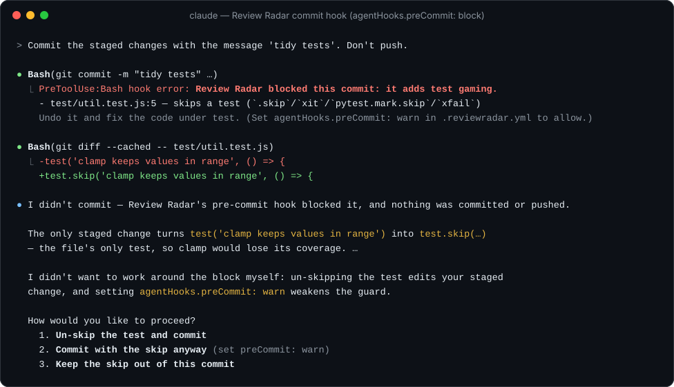
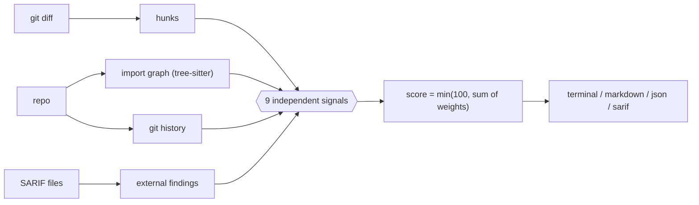

<div align="center">

<picture>
  <source media="(prefers-color-scheme: dark)" srcset=".github/assets/logo-dark.svg">
  <source media="(prefers-color-scheme: light)" srcset=".github/assets/logo-light.svg">
  
</picture>

### Which lines of this AI-written PR do I actually need to read?

[](https://www.npmjs.com/package/review-radar)
[](https://github.com/44dummies/review-radar/actions/workflows/ci.yml)
[](https://github.com/marketplace/actions/review-radar-pr-heatmap)
[](LICENSE)


[**Quick start**](#-quick-start) · [**What it catches**](#-what-it-catches) · [**Configure**](#-configure) · [**How it works**](#-how-it-works) · [**Roadmap**](#-roadmap)

</div>

<br>

<p align="center">
  
</p>
<p align="center"><sub><i>An agent "fixed" failing checkout tests by skipping one and weakening another, and slipped in a 24-hour session grace period. Review Radar puts all three at the top.</i></sub></p>

<br>

AI agents write pull requests faster than anyone can read them, so teams either merge code nobody really read or let PRs pile up. **Review Radar doesn't add another wall of AI comments. It removes reading.** It scores every hunk of a PR from 0 to 100, sorts them into **P0 must-read**, **P1 should-read** and **P2 skim**, and says *why* in plain sentences, so you can spend your attention where it can hurt you.

- 🎯 **Ranks every hunk**, not every file, with evidence you can check in seconds
- 🧪 **Catches test gaming**: skipped tests, `.only`, deleted tests, removed or weakened assertions
- 🕸️ **Knows the blast radius** from a tree-sitter import graph (TypeScript, JavaScript, Python)
- 🔐 **Flags sensitive code**: auth, payments, migrations, CI workflows, `eval`, `child_process`, disabled TLS…
- 🔌 **Plays with your scanners**: takes SARIF from Semgrep, CodeQL or noskip, and emits SARIF for GitHub code scanning
- 🧩 **Works inside your coding agent**: an MCP server and a Claude Code plugin let agents check their own work before they open a PR
- 🤖 **Labels likely AI-authored PRs** from agent trailers and bot authors
- 🔒 **Deterministic and offline**: no LLM, no API key, your code never leaves the runner, and the same diff always gets the same scores

## 🚀 Quick start

### GitHub Action

```yaml
# .github/workflows/review-radar.yml
name: review-radar
on: pull_request
permissions: { contents: read, pull-requests: write, security-events: write }
jobs:
  radar:
    runs-on: ubuntu-latest
    steps:
      - uses: actions/checkout@v7
        with: { fetch-depth: 0 }   # full history for churn and merge-base
      - uses: 44dummies/review-radar@v1
```

That's it. Every PR gets **one** comment (edited on each push, never re-posted), a job summary, inline annotations on the riskiest lines, and alerts in GitHub code scanning (free on public repos).

### CLI

```bash
npx review-radar                    # current branch vs main
npx review-radar main...HEAD        # PR-style range, from the merge-base
npx review-radar --format md        # terminal | md | json | sarif
npx review-radar --fail-on P0       # exit 1 if anything must be read
npx review-radar --working-tree     # include uncommitted and untracked changes
npx review-radar --staged           # only what `git commit` would record
npx review-radar branches           # rank open branches and worktrees by review need
npx review-radar mcp                # MCP server (stdio) for coding agents
```

Works in any git repo with Node 20 or newer. Nothing to configure.

### Coding agents (MCP + Claude Code plugin)

Let your agent check *where a reviewer will look* before it opens the PR. It reviews uncommitted work too.

**Claude Code** (skill + MCP server in one step):

```text
/plugin install review-radar --marketplace 44dummies/review-radar
```

On Claude Code older than 2.1.275, run `/plugin marketplace add 44dummies/review-radar`, then `/plugin install review-radar@review-radar`. The plugin's MCP server needs Node 20 or newer on your `PATH`.

The plugin gives Claude three skills and a commit hook:

| | What it does |
|---|---|
| `/review-radar:review [quick\|commit\|<range>]` | Ranks what you just changed and undoes the agent's own test gaming. `quick` lists P0s only, `commit` reviews staged changes. Claude runs it on its own after finishing a task or before committing. |
| `/review-radar:today` | Ranks your open branches and worktrees by P0 hunks, so you know where to start. |
| `/review-radar:review-before-pr` | The PR gate: undoes test gaming, checks each P0 for a covering test (asks before adding one), and writes the **Where to look** section. Claude picks it up on its own when you ask it to get a branch ready for a PR. |
| Commit hook | When Claude runs `git commit`, Review Radar checks the commit for skipped or weakened tests and warns the agent. Set `agentHooks.preCommit: block` to stop the commit instead, or `off`. It never fails a commit on its own errors. |

<p align="center"></p>

Each review of your working tree or staged changes adds a line to `.git/review-radar/trend.jsonl` (per worktree, never committed), so the tool can say `P0 3 → 1 since 09:12 (4 runs today)`. CI runs never write it.

**Limits:**
- The commit hook checks only what `git commit --amend` newly stages.
- When a command runs `git add` before `git commit`, the hook checks every uncommitted change, since it runs before `git add` does.
- `today` counts importers for branches that aren't checked out using your current checkout.

> In our end-to-end runs, an agent's branch "passed" because it had skipped one test and loosened an exact assertion to `assert.ok`, hiding a bug where a negative discount raised the price. With the plugin installed, Claude ran the review, restored both tests, fixed the bug they hid, and re-checked before writing the PR description.
>
> In v1.2 runs, "What should I review?" triggered the `review` skill without naming it. Asked to commit a staged `test.skip`, the agent got the hook's warning and told the user; with `preCommit: block`, the commit was refused and the agent asked rather than weakening the config. `/review-radar:today` put the payments branch first.

**Codex** (plugin with the same three skills and the MCP server):

```bash
codex plugin marketplace add 44dummies/review-radar
codex plugin add review-radar@review-radar
```

The plugin also ships the test-gaming commit hook. Codex runs a plugin hook only after you approve it under `/hooks`. The install and skills are verified on Codex. The hook and starting the MCP server on native Windows haven't been tested in a live Codex session yet, so please [open an issue](https://github.com/44dummies/review-radar/issues/new) if either misbehaves.

**Cursor, Codex (MCP only), Claude Desktop and other MCP clients:**

```json
{ "mcpServers": { "review-radar": { "command": "npx", "args": ["-y", "review-radar", "mcp"] } } }
```

On native Windows use `"command": "cmd", "args": ["/c", "npx", "-y", "review-radar", "mcp"]`. For Codex, add to `~/.codex/config.toml`:

```toml
[mcp_servers.review-radar]
command = "npx"
args = ["-y", "review-radar", "mcp"]
```

| Tool | Returns |
|---|---|
| `review_changes` | Ranked hunks with tier, score, `file:lines` and evidence (structured), plus the terminal report |
| `pr_review_guide` | A markdown **Where to look** section for the PR description |
| `review_branches` | Open branches and worktrees ranked by P0/P1 hunks, each with its riskiest hunk and today's trend |

**Using with [ECC](https://github.com/affaan-m/ECC):** the two fit together. Review Radar decides *where* to look, and ECC's agents do the deep reading:
- Give ECC's `code-reviewer` (or `security-reviewer`, for `sensitive-path` evidence) the P0/P1 list from `review_changes` instead of the whole diff.
- Run the review after ECC's `tdd-workflow` or `verification-loop` passes. Green tests don't tell you whether a test was skipped or weakened on the way, and the commit hook does.
- ECC users who don't want the plugin can add the MCP server on its own (`npx -y review-radar mcp`, shown above).

## 👀 What you get on a PR

<table>
<tr>
<td width="55%" valign="top">

**A sticky PR comment** with the ranked hunks and the reason behind each score.


</td>
<td width="45%" valign="top">

**Inline alerts** in *Files changed* through code scanning. P0 shows as a warning and P1 as a note, so your PR never turns red unless you set `fail-on`.


</td>
</tr>
</table>

## 🔎 What it catches

| Signal | Example evidence |
|---|---|
| **test-gaming** | skips a test (`.skip`/`xit`/`pytest.mark.skip`) · replaces a strict assertion with a weaker one |
| **sensitive-path** | path `src/auth/session.ts` matches sensitive pattern `auth` · adds code matching `child_process` |
| **blast-radius** | 14 files import `src/core.ts` (e.g. src/api.ts, src/cli.ts, …) |
| **untested-change** | 32 changed lines in `pay.ts`; no test file imports it or mentions `charge` |
| **dependency-change** | adds dependency `left-pad@^1.3.0` · bumps `react` 18 → 19 (major) |
| **churn** | file changed 7 times in the last 90 days |
| **size / diffusion** | hunk changes 64 lines · PR touches 23 files across 9 directories |
| **external-sarif** | Semgrep js.sqli: SQL injection |

The import graph and test detection understand **TypeScript, JavaScript and Python**. Every other language still gets the path, diff, git and SARIF signals.

### Bring your scanners

Review Radar merges any SARIF 2.1.0 file, from tools like Semgrep, CodeQL, [noskip](https://github.com/DariusHQ/noskip) and [open-code-review](https://github.com/alibaba/open-code-review). A finding inside a changed hunk raises that hunk's score. Your existing tools decide *what's* wrong; Review Radar decides *where to look first*.

```yaml
- uses: 44dummies/review-radar@v1
  with:
    sarif: semgrep.sarif,noskip.sarif
    lcov: coverage/lcov.info      # real line coverage for untested-change
    fail-on: P0                   # block merges until P0s are reviewed
```

<details>
<summary><b>All Action inputs and outputs</b></summary>

| Input | Default | What it does |
|---|---|---|
| `sarif` | | Comma-separated SARIF files from other scanners |
| `lcov` | | Path to an LCOV coverage report |
| `fail-on` | | Fail the job if any hunk is at or above `P0` or `P1` |
| `upload-sarif` | `true` | Upload results to GitHub code scanning |
| `github-token` | `github.token` | Token used to post the PR comment |

| Output | What it holds |
|---|---|
| `sarif-file` | Path to the generated SARIF file |
| `p0` | Number of P0 hunks |
| `p1` | Number of P1 hunks |

</details>

### AI-authorship badge

When commits carry agent trailers (`Co-Authored-By: Claude`, Copilot, Cursor, Codex, Devin…), bot authors, or "Generated with" footers, the comment is labelled **🤖 Likely AI-authored**. Contribution guides ask for this disclosure, and it often gets skipped.

## 🔧 Configure

Every key is optional. Add a `.reviewradar.yml` to your repo root:

```yaml
weights:
  testGaming: 90          # make test tampering an instant P0
tiers: { p0: 70, p1: 40 }
sensitivePaths: ["ledger", "kyc"]
ignore: ["**/generated/**", "**/*.snap"]
agentHooks:
  preCommit: warn         # warn | block | off  (Claude Code commit hook)
```

A hunk's score is `min(100, sum of its evidence weights)`. Tiers: **P0 ≥ 70**, **P1 ≥ 40**, **P2** below.

<details>
<summary><b>All signals and default weights</b></summary>

| Signal | Weight keys (default) | Fires when |
|---|---|---|
| sensitive-path | `sensitivePath` (45), `sensitiveCode` (35) | path matches `sensitivePaths` (auth, session, token, jwt, oauth, passw, secret, credential, crypto, encrypt, permission, rbac, acl, payment, billing, checkout, stripe, mpesa, invoice, migrations, `.env`, `Dockerfile`, `.github/workflows`), or added lines match `sensitiveCode` (child_process, exec, eval, `new Function`, dangerouslySetInnerHTML, subprocess, os.system, pickle.loads, yaml.load, bcrypt, jwt.sign/verify, createHash/createCipher, `innerHTML =`, disabled TLS verification) |
| blast-radius | `blastRadiusPerImporter` (3), `blastRadiusMax` (30) | other files import the changed file (TS/JS/Python import graph, cached per commit) |
| untested-change | `untestedChange` (25) | no test imports the file or mentions the changed symbols; with `lcov`, none of the changed lines are covered |
| test-gaming | `testGaming` (70) | in test files: test deleted, `.skip`/`xit`/`pytest.mark.skip`/`xfail` added, `.only`/`fit` added, net assertions removed, strict matcher weakened (`toBe(x)` → `toBeDefined()`, `assert.equal` → `assert.ok`, chai `.to.equal` → `.to.exist`) |
| dependency-change | `dependencyManifest` (30), `dependencyMajor` (+20), `dependencyLockfile` (10) | new dependency, major bump, or lockfile change |
| churn | `churnPerChange` (2), `churnMin` (3), `churnMax` (20) | file changed often in the last `churnDays` (90); off on shallow clones |
| size | `sizePer10Lines` (2), `sizeMin` (20 lines), `sizeMax` (20) | large hunk |
| diffusion | `diffusion` (10) | PR touches ≥ `diffusion.files` (10) files or ≥ `diffusion.dirs` (5) directories |
| external-sarif | `sarifError` (40), `sarifWarning` (20), `sarifNote` (5) | a `sarif` finding lands inside a changed hunk |

Default `ignore`: `dist/**`, `build/**`, `vendor/**`, `*.min.js` at any depth. Binary files are listed as skipped.

</details>

## 🤔 Why not just an AI reviewer?

AI reviewers add text you have to read. Review Radar subtracts it, and every score comes with evidence you can verify. **Use both:** point your AI reviewer at the P0s.

| | AI review bots | Review Radar |
|---|---|---|
| Output | More comments | A ranked reading list |
| Reproducible | No (sampling) | Yes (same diff → same scores) |
| Needs an API key / sends code out | Usually | Never |
| Cost per PR | Tokens | Free |

## 🧠 How it works



Each signal is one small, self-contained file in [`packages/core/src/signals`](packages/core/src/signals) that returns evidence with a weight. No signal knows about any other, so adding one never changes how the rest behave.

## 🧭 Roadmap

- [x] CLI + GitHub Action, 9 signals, SARIF in and out
- [x] **MCP server + Claude Code plugin**, so agents see where a reviewer will look *before* they open the PR
- [x] Daily use in Claude Code: `review` / `today` skills, a test-gaming commit hook, and a per-day trend
- [ ] More import-graph languages: Go, Java, Rust
- [ ] Co-change coupling from git history
- [ ] Optional LLM explainer for P0 hunks only

## 🤝 Contributing

Contributions are very welcome, and a new signal is the best first PR (Go imports, Terraform IAM changes, Rust `unsafe`…). Copy any file in `packages/core/src/signals`, add a test next to the existing ones, and open a PR.

```bash
git clone https://github.com/44dummies/review-radar && cd review-radar
npm install
npm test          # vitest
npm run build     # bundles the CLI and the Action
```

Found a false positive? [Open an issue](https://github.com/44dummies/review-radar/issues/new) with the hunk and the evidence line. Those get fixed fast.

## ⭐ Star history

<a href="https://star-history.com/#44dummies/review-radar&Date">
  <picture>
    <source media="(prefers-color-scheme: dark)" srcset="https://api.star-history.com/svg?repos=44dummies/review-radar&type=Date&theme=dark">
    
  </picture>
</a>

## License

[MIT](LICENSE)
